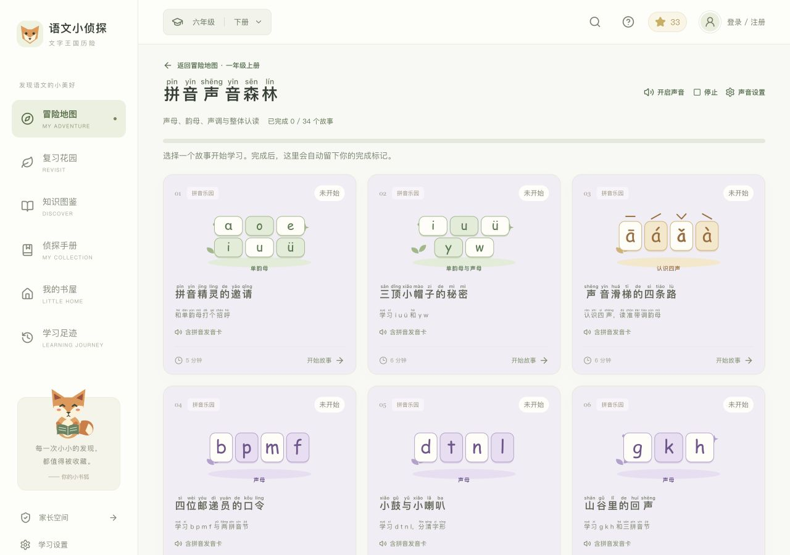
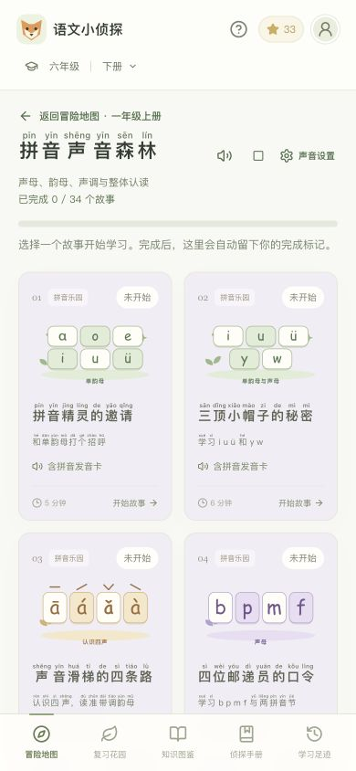
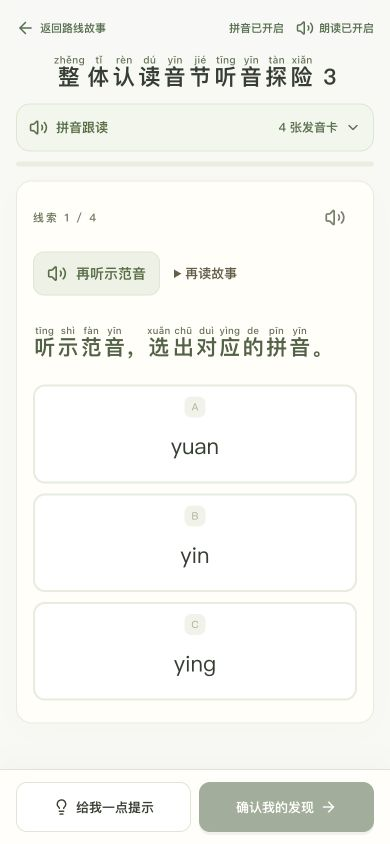

<div align="center">


# 语文小侦探 · 文字王国历险

**跟着小书狐找线索、读故事，把语文学习变成一场小小的冒险。**

面向小学 **1—6 年级**的趣味语文学习 Web 应用，适配电脑、手机和平板。

[**在线体验 → chinese.liuliang8.top**](https://chinese.liuliang8.top) · [快速启动](#快速启动) · [使用指南](docs/使用指南.md) · [开发与部署](docs/开发与部署.md) · [参与贡献](CONTRIBUTING.md)

**347 个主题关卡 · 856 道主线题 · 773 张独立字卡 · 4,851 条来源知识点**

</div>


> **许可说明：** 本项目自行编写的应用代码和文档采用 [MIT](LICENSE)；随附知识点数据按上游 [PolyForm Noncommercial 1.0.0](https://polyformproject.org/licenses/noncommercial/1.0.0) 提供，使用这些数据进行商业活动需另行取得相应授权。详见 [第三方来源与许可](THIRD_PARTY_NOTICES.md)。

## 这是什么？

语文小侦探把拼音、识字、阅读与表达组织成一条条故事路线：选择路线，接下小书狐的委托，在听、读、选、排、说、写中寻找答案。完成后留下进度与学习足迹，再到复习花园回顾需要巩固的目标。

可以用于家庭亲子陪伴、自主练习，也适合开发者研究课程数据、学习记录和儿童学习界面的实现。课程由项目自编，配合学校教材使用；不承诺与某一教材版本逐课同步，也不替代教师指导。

## 看看它怎么学

### 1. 选一条路线，开始一段故事

一至六年级均可切换上下册。进入路线后只展示该路线的故事，每个故事标记“未开始 / 学习中 / 已完成”。

### 2. 拼音有自己的声音和封面

声母、韵母、四声与整体认读使用对应的封面。点发音卡听汉语拼音录音，再跟着读；拼音不会交给英文音色按英文字母朗读。听辨题保留“先听再选”，不自动念出答案选项。



### 3. 全屏找线索，专心做发现

学习页隐藏全站导航，保留返回、拼音与朗读开关；题目、选项和固定在底部的按钮优先显示。需要时展开故事材料或重听示范音，离开后可以继续未完成的学习。


### 4. 手机和平板也能慢慢学

响应式布局适配触屏操作。主要操作按钮固定在底部，中文文字支持注音开关；长篇阅读或展开的练习保留自然滚动。

<p align="center">
  
  &nbsp;&nbsp;
  
</p>

*以上为项目演示界面截图，包含开发演示进度；不包含真实学习者资料。*

## 主要功能

| 模块 | 可以做什么 |
| --- | --- |
| 冒险地图 | 按年级、上下册和主题路线学习，查看故事完成状态 |
| 拼音森林 | 声母、韵母、声调、整体认读、拼读与听辨；配套拼音录音 |
| 字表练习场 | 一年级上下册独立认读字卡、田字格与四线格练写 |
| 阅读与表达 | 自编短文、选择与排序、口头讲述、札记和习作 |
| 复习花园 | 根据目标表现与复习间隔安排回顾，保留复习记录 |
| 学习足迹 | 查看作答历史、提示/重试、独立完成和作品记录 |
| 侦探手册与书屋 | 收藏学习发现，用课程奖励解锁书屋装饰 |
| 知识图鉴 | 按年级、册次、分类和关键词查阅知识点及教材出处 |
| 用户与偏好 | 注册、登录、游客记录迁移；拼音、音色、语速与音效设置 |
| 家长空间 | 查看学习目标、作品与人工填写的检查记录 |

## 课程范围

| 年级 | 上册主题关卡 | 下册主题关卡 | 合计 |
| --- | ---: | ---: | ---: |
| 一年级 | 64 | 43 | 107 |
| 二年级 | 24 | 24 | 48 |
| 三年级 | 24 | 24 | 48 |
| 四年级 | 24 | 24 | 48 |
| 五年级 | 24 | 24 | 48 |
| 六年级 | 24 | 24 | 48 |
| **总计** | **184** | **163** | **347** |

一年级另有 **773 张独立字卡**，不计入上表主题关卡：上册 280 个认读字 / 100 个会写字，下册 410 个认读字 / 200 个会写字。会写字与认读字有重叠，数量不应相加作为唯一汉字数。

- [一年级上册课程目录](docs/一年级上册课程目录.md)
- [二至六年级课程清单](docs/curriculum/二至六年级课程清单.md)
- [课程机器可读清单](docs/curriculum/catalog.json)
- [知识点检查与补充建议](docs/audit/一至六年级知识点检查与补充建议.md)

数据导入和自动关联不等于完成全部教材覆盖。二至六年级目前是能力主题课程，尚不包含每册完整识写字表和所有课文的逐课同步；题目仍欢迎语文教师参与复核。

## 快速启动

### 环境

- Node.js **20.18 或更新版本**，建议使用 Node.js 24。
- npm；首次安装依赖需要网络。
- 现代浏览器；中文朗读效果取决于设备可用的中文音色。

### 获取并运行

在本仓库点击 **Code → Download ZIP** 并解压，或通过 **Open with GitHub Desktop** 克隆。也可以使用 Git：

```bash
git clone https://github.com/magicboy5300/wordland-learning.git
cd wordland-learning
```

进入含 `package.json` 的项目目录执行：

```bash
npm ci
npm run dev
```

打开 [http://localhost:5178](http://localhost:5178)。API 服务运行于 `3001` 端口，健康检查为 [http://localhost:3001/api/health](http://localhost:3001/api/health)。课程和拼音音频已随仓库提供，默认运行不需要 Azure、付费语音服务或 AI API Key。

首次运行自动创建本地数据库，无需安装独立数据库服务器。按 `Ctrl+C` 停止开发服务。

### 打包运行

```bash
npm run build
npm start
```

以上生产启动命令适用于 macOS / Linux。Windows PowerShell 使用：

```powershell
npm run build
$env:NODE_ENV = "production"
node server/index.js
```

构建后的页面和 API 由同一个 Express 服务提供，访问 [http://localhost:3001](http://localhost:3001)。这是完整的应用服务，不能只上传前端文件到 GitHub Pages 来保留登录和学习历史。公网部署、环境变量和备份方法见 [开发与部署](docs/开发与部署.md)。

## 第一次使用

1. **选择年级与上下册**：先从与孩子当前学习阶段相近的内容开始。
2. **进入路线和故事**：例如一年级上册 → 拼音声音森林 → 单韵母或听音探险。
3. **开启声音**：首次播放可能需要手动点击；可在学习设置选择中文音色、语速和音效。
4. **完成一段学习**：阅读故事，点击“我准备好了”，听题、观察卡片，再确认选择。
5. **留下记录**：完成后查看足迹；需要时注册或登录，并按界面选项迁移游客记录。
6. **回到复习花园**：巩固需要练习的目标，也可以完成说写小作品。

完整的图文流程、账号说明和语音常见问题见 [使用指南](docs/使用指南.md)。

## 数据放在哪里？

- **本地运行**：默认保存于 `.runtime/wordland.sqlite`，由单个 Node.js 进程中的 sql.js 服务读写；含账号、会话和学习记录，请自行妥善备份。
- **浏览器偏好**：音色、语速、拼音开关等保存在当前浏览器。
- **在线演示**：独立部署、独立数据库；下载源码不会得到演示站账号或学习记录，演示站也不会自动同步到本地。
- **仓库内容**：仅课程、公开来源数据、音频、代码和文档；不包含运行数据库、密钥或现有站点的部署凭据。

同一账号只有连接到同一应用服务和数据库时才能跨设备继续学习。游客记录依赖当前服务与浏览器身份，不是纯前端离线存储。

## 项目结构

```text
src/                 React + TypeScript 界面、交互、注音与音频播放
server/              Express API、用户认证、判题、复习和 SQLite 持久化
server/curriculum/   二至六年级自编能力课程
public/              小书狐图标、拼音录音和素材署名
data/                知识点、教材来源和一年级字表
scripts/             数据导入、课程导出、音频处理与课程审查脚本
tests/               已有 API 测试
docs/                使用说明、课程清单、审查报告和界面截图
```

技术栈：**React 19 · TypeScript · Vite · Express · sql.js / SQLite · pinyin-pro · lucide-react**。

这个仓库提供可独立运行的 Node.js 版本；在线站点使用的托管平台专用工作目录不包含在仓库中。

## 当前边界与后续方向

- 尚未接入邮箱验证、邮件找回密码、多孩子档案及账号删除界面。
- 中文剧情和说明使用浏览器/系统语音，音色与自动播放能力因设备而异。
- 口语、背诵、作文和写字采用自评或家长填写检查，不提供自动质量评分、发音评分或笔顺判定。
- 完整离线学习暂未实现；保存进度与提交答案需要连接应用服务。
- 本地 sql.js 数据库适合单进程运行，横向扩容或多人正式使用前应另行评估数据库、账号与运维方案。
- 优先欢迎：课程纠错、教材版次核对、拼音与多音字校正、真实教学反馈、无障碍与触屏体验改进。

## 参与贡献

欢迎提交课程纠错、Bug 报告、文档和功能改进。请先阅读 [贡献指南](CONTRIBUTING.md)。报告课程问题时附上年级、册次、路线、故事名称和题目截图即可；不要附真实姓名、邮箱、密码或学习数据库。

## 致谢与许可

- 知识点来源：[mmlong818/k12-knowledge-points](https://github.com/mmlong818/k12-knowledge-points)。
- 拼音录音：[davinfifield/mp3-chinese-pinyin-sound](https://github.com/davinfifield/mp3-chinese-pinyin-sound)，采用 Unlicense，保留原文及剪辑说明。
- 汉字转拼音：[pinyin-pro](https://github.com/zh-lx/pinyin-pro)，保留其许可。

**应用代码：[MIT License](LICENSE)。第三方数据和素材：[来源与许可说明](THIRD_PARTY_NOTICES.md)。**

Required Notice: Copyright © 2026 猫叔 (https://github.com/mmlong818/k12-knowledge-points)
